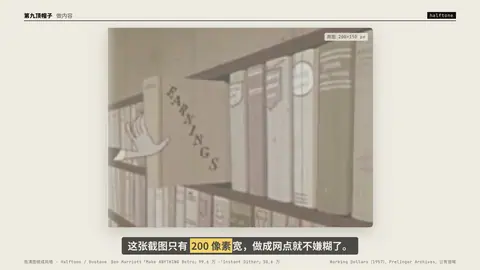
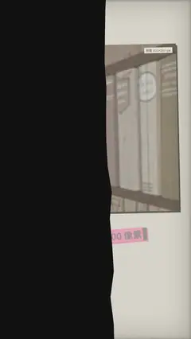

# `halftone` · 

 

**怎么动**：

| 项 | 内容 |
|---|---|
| 类别 | 照片 |
| 适合的句子 | 老照片、低清截图、档案图 |
| 建议时长 | 3.5–5 秒 |
| 参数 | `cell`, `focus`, `image`, `ink`, `ink2`, `kicker`, `mode`, `paper`, `src`, `title` |
| 横屏 / 竖屏 | ✓ / ✓（尺寸用 vmin，竖屏自动缩放） |
| 人气依据 | Ben Marriott「Make ANYTHING Retro」99.6 万 ·「Instant Dither」30.6 万 |

```json
{
 "scene": "fx",
 "fx": "halftone",
 "theme": "paper",
 "topic": "做内容",
 "image": "assets/lowres_1957.jpg",
 "mode": "halftone",
 "kicker": "1957 年 · 公有领域档案片",
 "title": "200 像素，也能好看",
 "line": "这张截图只有 *200 像素*宽，做成网点就不嫌糊了。",
 "src": "Working Dollars（1957），Prelinger Archives，公有领域",
 "t": "@关键词"
}
```

**已知坑**：无
