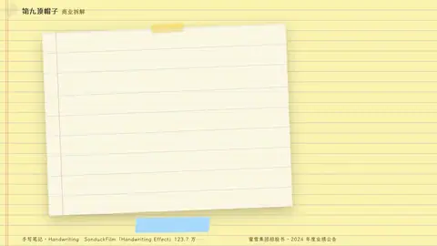
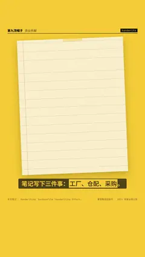

# `handwrite` · 

 

**怎么动**：

| 项 | 内容 |
|---|---|
| 类别 | 文档 |
| 适合的句子 | 学习笔记、拆解笔记 |
| 建议时长 | 每行 ≥0.4 秒 |
| 参数 | `font`, `ink`, `lines`, `mark`, `paper`, `text`, `tilt`, `title` |
| 横屏 / 竖屏 | ✓ / ✓（尺寸用 vmin，竖屏自动缩放） |
| 人气依据 | SonduckFilm「Handwriting Effect」123.7 万 · VideoHive Whiteboard Write 2.1K |

```json
{
 "scene": "fx",
 "fx": "handwrite",
 "theme": "lemon",
 "topic": "商业拆解",
 "title": "4 块钱的底气",
 "lines": [
  "一、*自有工厂*：原料自己做",
  "二、*自建仓配*：直送到店",
  "三、*规模采购*：4.6 万家店一起买"
 ],
 "host": true,
 "line": "笔记写下三件事：*工厂、仓配、采购*。",
 "src": "蜜雪集团招股书 · 2024 年度业绩公告",
 "t": "@关键词"
}
```

**已知坑**：手写字体来自 assets/fonts.json，构建机要能找到字体（设置 H9_MEDIA）。
