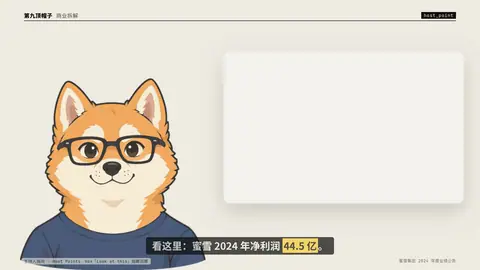

# `host_point` · 

 

**怎么动**：

| 项 | 内容 |
|---|---|
| 类别 | 音视频 |
| 适合的句子 | 主持人指着数字 / 结论 / 图里的细节 |
| 建议时长 | 5–6 秒 |
| 参数 | `card`, `host_fit`, `say`, `side` |
| 横屏 / 竖屏 | ✓ / ✓（尺寸用 vmin，竖屏自动缩放） |
| 人气依据 | Vox「Look at this」指哪说哪 |

```json
{
 "scene": "fx",
 "fx": "host_point",
 "theme": "paper",
 "topic": "商业拆解",
 "card": {
  "kind": "number",
  "value": 44.5,
  "unit": "亿元",
  "label": "蜜雪集团 · 2024 年净利润",
  "sub": "同比 +39.8%"
 },
 "say": "看这里！",
 "at": 1.6,
 "src": "蜜雪集团 2024 年度业绩公告",
 "line": "看这里：蜜雪 2024 年净利润 *44.5 亿*。",
 "t": "@关键词"
}
```

**已知坑**：图片卡的 box 写原图百分比，裁切会自动朝框的方向。
