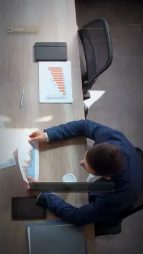

# `hud_lock` · 

 

**怎么动**：

| 项 | 内容 |
|---|---|
| 类别 | 界面 |
| 适合的句子 | 锁定目标、指出关键人 / 物、选址 |
| 建议时长 | 3 秒 |
| 参数 | `image`, `readouts`, `text`, `v`, `video`, `video_start` |
| 横屏 / 竖屏 | ✓ / ✓（尺寸用 vmin，竖屏自动缩放） |
| 人气依据 | Quantum HUD Infographic 5.9K（Infographics 第 1） |

```json
{
 "scene": "fx",
 "fx": "hud_lock",
 "theme": "ink",
 "topic": "商业拆解",
 "image": "assets/broll/meeting.jpg",
 "x": 61,
 "y": 46,
 "w": 22,
 "h": 40,
 "text": "拍板的人",
 "readouts": [
  "TARGET · 决策人",
  "ROLE · 最后拍板",
  "STATUS · 观望中"
 ],
 "line": "谈判桌上，先*盯住拍板的人*。",
 "v": {
  "x": 30,
  "y": 44,
  "w": 62,
  "h": 34,
  "ox": 75
 },
 "t": "@关键词"
}
```

**已知坑**：竖屏会裁图，用 v: {x, y, w, h, ox} 单独给竖屏的框和裁切位置。
