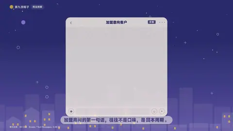
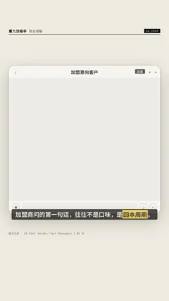

# `im_chat` · 

 

**怎么动**：

| 项 | 内容 |
|---|---|
| 类别 | 界面 |
| 适合的句子 | 聊天记录、对话证据 |
| 建议时长 | 4–6 秒 |
| 参数 | `items`, `messages`, `mock`, `mock_label`, `read`, `title` |
| 横屏 / 竖屏 | ✓ / ✓（尺寸用 vmin，竖屏自动缩放） |
| 人气依据 | Envato「Text Messages」3.8K 份 |

```json
{
 "scene": "fx",
 "fx": "im_chat",
 "theme": "paper",
 "topic": "商业拆解",
 "mock": true,
 "read": true,
 "line": "加盟商问的第一句话，往往不是口味，是*回本周期*。",
 "title": "加盟意向客户",
 "messages": [
  {
   "from": "对方",
   "text": "你好，想了解一下加盟",
   "time": "09:41"
  },
  [
   "我",
   "您好，请问计划开在哪个城市？"
  ],
  [
   "对方",
   "三线城市，县城中心"
  ],
  [
   "对方",
   "多久能回本？"
  ],
  {
   "from": "我",
   "voice": 8
  },
  {
   "from": "对方",
   "recall": true
  },
  [
   "对方",
   "原料必须从总部统一采购吗？"
  ],
  [
   "我",
   "是的，按您的选址我先给您算一笔账"
  ]
 ],
 "t": "@关键词"
}
```

**已知坑**：无
