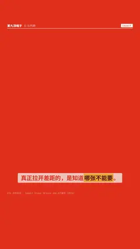

# `impact` · 冲击抖动 (#24, Bricks 106.8万 2025)

 

**怎么动**：the title slams in and the whole frame takes a decaying camera shake.

| 项 | 内容 |
|---|---|
| 类别 | 字效 |
| 适合的句子 | 重点结论、冲击句 |
| 建议时长 | 2–3 秒 |
| 参数 | — |
| 横屏 / 竖屏 | ✓ / ✓（尺寸用 vmin，竖屏自动缩放） |
| 人气依据 | Bricks 106.8万播放（2025） |

```json
{
 "scene": "fx",
 "fx": "impact",
 "theme": "red",
 "topic": "AI 与判断",
 "text": "不能要",
 "sub": "know what to throw away",
 "line": "真正拉开差距的，是知道*哪张不能要*。",
 "t": "@关键词"
}
```

**已知坑**：无
