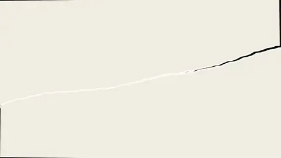
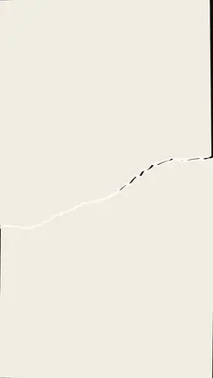

# `ink_reveal` · 墨迹显影

 

**怎么动**：墨点落在纸上晕开——墨团边缘是湿的、乱的（SVG 湍流位移），越扩越大连成一片，标题（和这一拍的图，如果有）在墨里显出来，用底色反白。墨用风格的文字色或强调色，任何底色上都能用。

| 项 | 内容 |
|---|---|
| 类别 | 有机质感 |
| 适合的句子 | 开篇、点题、一个有分量的词 |
| 建议时长 | 4–5 秒 |
| 参数 | `text` 或 `image` 至少一个、`sub`（下面一行）、`ink`（fg / accent）、`at` |
| 横屏 / 竖屏 | ✓ / ✓（竖屏：墨团铺满到底边，字在字幕带上方；横屏同理） |
| 跟风格换皮 | 颜色只用风格的 token（--bg --fg --muted --accent --card --card-fg），字体用风格的 display / body / num；没写 `theme` 时画在风格自己的底色上 |
| 什么时候用 | 需要质感、情绪、东方气质的标题 |
| 什么时候不用 | 数据密集的信息（墨团会挡住） |
| 同步口播 | 有字级时间戳（meta.words）时，条目 / 关键时刻落在说到它的那一刻；`at` 可以写 `"@词"` 或拍内秒数 |
| 缺内容 | 必填参数缺了会直接报错（不会画空骨架）；确实要骨架时写 `"skeleton": true` |

```json
{
 "scene": "fx",
 "fx": "ink_reveal",
 "topic": "商业拆解",
 "text": "刨冰摊起家",
 "sub": "1997 · 郑州",
 "line": "蜜雪冰城 1997 年从郑州的一个*刨冰摊*起家。",
 "src": "蜜雪集团招股书",
 "t": "@关键词"
}
```

**已知坑**：滤镜每帧重算，长时间用会慢一点；建议 ≤ 6 秒。
