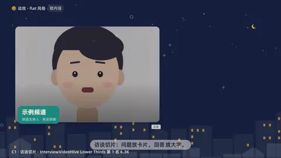

# `interview` · 

 

**怎么动**：

| 项 | 内容 |
|---|---|
| 类别 | 人物 |
| 适合的句子 | 访谈 / 播客切片、嘉宾金句 |
| 建议时长 | 4–8 秒（跟片段一样长） |
| 参数 | `a`, `at_a`, `at_q`, `ep`, `focus`, `host`, `image`, `name`, `org`, `q`, `role`, `start`, `tc`, `topic`, `video` |
| 横屏 / 竖屏 | ✓ / ✓（尺寸用 vmin，竖屏自动缩放） |
| 人气依据 | VideoHive Lower Thirds 第 1 名 6.3K |

```json
{
 "scene": "fx",
 "fx": "interview",
 "theme": "ink",
 "topic": "做内容",
 "line": "访谈切片：问题放卡片，*回答*放大字。",
 "video": "../../assets/host.webm",
 "name": "示例频道",
 "role": "频道主持人",
 "org": "商业拆解",
 "q": "做一条口播，最花时间的是哪一步？",
 "a": "不是剪辑，是*想清楚每句话配什么画面*。",
 "ep": "第 1 段",
 "tc": "12:04",
 "mock": "示意",
 "t": "@关键词"
}
```

**已知坑**：q / a 要是嘉宾真实说过的话，或标 mock；竖版素材用 focus 选人脸位置。
