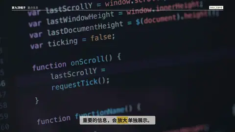
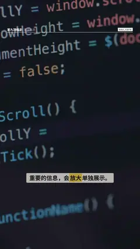

# `key_card` · 重点信息卡

 

**怎么动**：主体先在画面里，然后一张 KEY INFO 卡从主体身后放大出来，四个角标收拢，主体虚化变暗；卡里的数值按 `@词` 轮换（174 → 18 → 15），每次轮换角标弹一下、右上角页码跳一格。

| 项 | 内容 |
|---|---|
| 类别 | 重点信息（贴在主体旁） |
| 适合的句子 | 一段话里有 2–3 个关键数，要「单独拎出来」给观众看 |
| 建议时长 | 3.5–5 秒（每个数 ≥ 1 秒） |
| 参数 | `values`（1–6 个：`v` `unit` `cap` `at`；`cap` 里可用 `*词*`）、`kicker`、`at`（卡出来的时间）、`subject` / `video` / `image`、`layout`（full / card） |
| 横屏 / 竖屏 | ✓ / ✓（竖屏：卡在上半屏，主体卡占下半屏；全屏素材时卡居中） |
| 跟风格换皮 | 字体、强调色、圆角、描边、阴影、重点词的标法（色块 / 下划线 / 马克笔 / 墨晕）都从风格来（`scripts/h9/fx/_kinfo.py` 的 `SKINS`） |
| 章节底色 | beat 没写 `theme` 时，颜色跟着这一章的 `chapter.bg` 颜色世界走（`scripts/h9/device.py`），深色、浅色、强调色章节都可读；在主持人区域里（`presenter.py`）按区域大小排版 |
| 参考 | 抖音开源竖屏模板宣传片（douyin 7701488753897917723）的同类版式 |

没有主体时：卡从一叠扇开的空白卡里出来，底下是点阵。

```json
{
 "scene": "fx",
 "fx": "key_card",
 "d": 5.0,
 "theme": "ink",
 "topic": "重点信息",
 "subject": "$H9_MEDIA/broll/tech/code-on-screen-scrolling_mixkit-1728.mp4",
 "values": [
  {
   "v": "174",
   "cap": "个动效 · 开源竖屏模板"
  },
  {
   "v": "18",
   "cap": "种风格 · 横竖屏都有"
  },
  {
   "v": "15",
   "unit": "个",
   "cap": "版本 · *7 天内*"
  }
 ],
 "line": "重要的信息，会*放大*单独展示。"
}
```
