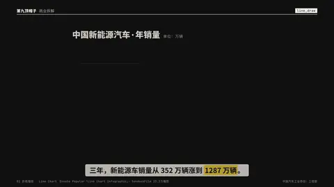
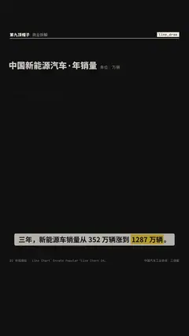

# `line_draw` · 

 

**怎么动**：

| 项 | 内容 |
|---|---|
| 类别 | 数据 |
| 适合的句子 | 趋势、增长曲线、穿过零线的变化 |
| 建议时长 | 3–4 秒 |
| 参数 | `compact`, `dec`, `note`, `points`, `title`, `unit` |
| 横屏 / 竖屏 | ✓ / ✓（尺寸用 vmin，竖屏自动缩放） |
| 人气依据 | Envato Popular「Line Chart Infographic」· SonduckFilm 23.2万播放 |

```json
{
 "scene": "fx",
 "fx": "line_draw",
 "theme": "ink",
 "topic": "商业拆解",
 "points": [
  [
   "2021",
   352.1
  ],
  [
   "2022",
   688.7
  ],
  [
   "2023",
   949.5
  ],
  [
   "2024",
   1286.6
  ]
 ],
 "unit": " 万辆",
 "dec": 1,
 "title": "中国新能源汽车 · 年销量",
 "note": "单位：万辆",
 "line": "三年，新能源车销量从 352 万辆涨到 *1287 万辆*。",
 "src": "中国汽车工业协会；工信部",
 "t": "@关键词"
}
```

**已知坑**：点很多时横轴标签自动隔几个显示；有负数时画零线，面积填到零线。
