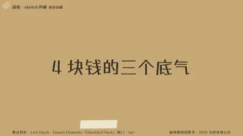
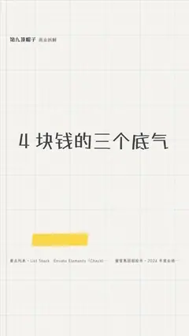

# `list_stack` · 

 

**怎么动**：

| 项 | 内容 |
|---|---|
| 类别 | 结构 |
| 适合的句子 | 「三个原因」「四个要点」、清单、结尾总结 |
| 建议时长 | 每条 0.6–1 秒 + 1 秒 |
| 参数 | `hl`, `items`, `strike`, `style`, `title` |
| 横屏 / 竖屏 | ✓ / ✓（尺寸用 vmin，竖屏自动缩放） |
| 人气依据 | Envato Elements「Checklist Pack」热门 · talkcraft numbered-step-stack |

```json
{
 "scene": "fx",
 "fx": "list_stack",
 "theme": "paper",
 "topic": "商业拆解",
 "title": "4 块钱的三个底气",
 "items": [
  [
   "自有工厂",
   "原料和包材自己生产"
  ],
  [
   "自建仓配",
   "从仓库直接送到门店"
  ],
  [
   "规模采购",
   "4.6 万家店一起下单"
  ]
 ],
 "line": "蜜雪能卖 4 块钱，靠的是*三件事*。",
 "src": "蜜雪集团招股书 · 2024 年度业绩公告",
 "t": "@关键词"
}
```

**已知坑**：条目里的「：」会把后半句拆成小字说明；不想拆就用 ["整句", ""]。
