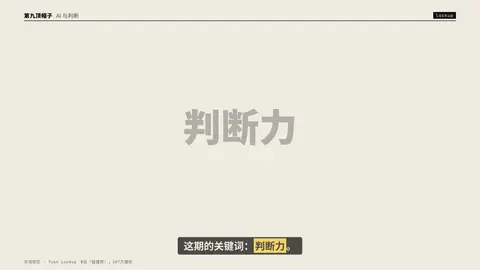
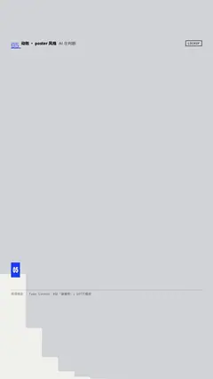

# `lockup` · 中英双语锁定 + 注释引线 (type specimen lockup)

 

**怎么动**：headline, latin line, two leader-line annotations.

| 项 | 内容 |
|---|---|
| 类别 | 字效 |
| 适合的句子 | 中英双语标题、字体展示 |
| 建议时长 | 2–3 秒 |
| 参数 | `notes`, `sub`, `text` |
| 横屏 / 竖屏 | ✓ / ✓（尺寸用 vmin，竖屏自动缩放） |
| 人气依据 | B站「碰撞吧！」107万播放 |

```json
{
 "scene": "fx",
 "fx": "lockup",
 "theme": "paper",
 "topic": "AI 与判断",
 "text": "判断力",
 "sub": "JUDGMENT",
 "notes": [
  "思源黑体 Heavy",
  "Archivo Black"
 ],
 "line": "这期的关键词：*判断力*。",
 "host": true,
 "t": "@关键词"
}
```

**已知坑**：无
