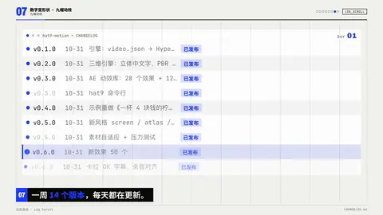
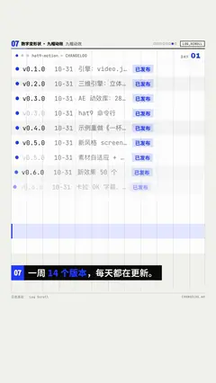

# `log_scroll` · 日志滚动 · Log Scroll

 

**怎么动**：终端 / 表格窗口里一行行真实日志往上滚，每行经过读线时闪一下强调色；标题栏角上的计数器跟着走（DAY 02 → 13，或 0 → 89 条），最后弹出一个上升标签（「加速提升中 ↑」）。同一版本的行自动归组（隔组底色、重复的版本号变淡），状态词画成小标签。

**什么时候用**：用「量」证明勤奋或规模：更新记录、修过的 bug、处理过的工单、跑过的实验。

| 项 | 内容 |
|---|---|
| 类别 | 数字变形状 |
| 建议时长 | 5–6 秒 |
| 横屏 / 竖屏 | ✓ / ✓ |

**参数**

| 参数 | 说明 |
|---|---|
| `lines` | 列表：字符串，或 [列, 列, …] |
| `file` | 文本文件，一行一条；列用 Tab 或 " | " 分 |
| `columns` | 表头（表格模式） |
| `chips` | 画成状态标签的词，默认 已发布/已解决/已修复/done/fixed… |
| `title` | 窗口标题 |
| `counter` | {label, from, to, pad} 或 "89 条" |
| `tag` | 结尾标签，以 ↑ 结尾时箭头会跳 |
| `visible` | 屏上行数 |
| `subject / subject_label` | 主体小卡 |
| `mock` | 示意标签 |

```json
{
 "scene": "fx",
 "fx": "log_scroll",
 "title": "hat9-motion — CHANGELOG",
 "lines": [
  [
   "v0.12.0",
   "11-03",
   "montage 卡拍快切",
   "已发布"
  ],
  [
   "v0.13.0",
   "11-06",
   "新风格 minimal 极简讲述",
   "已发布"
  ]
 ],
 "counter": {
  "label": "DAY",
  "from": 1,
  "to": 7,
  "pad": 2
 },
 "tag": "加速提升中 ↑",
 "line": "一周 *14 个版本*，每天都在更新。",
 "t": "@关键词"
}
```

所有这一组效果（数字变形状）：颜色、字体、圆角、描边、阴影、入场缓动都取自当前风格（18 种风格自动换皮）；横竖屏同一套参数；可选 `subject`（图片或视频）把主讲人放在旁边的小卡里。

**已知坑**：行数少于屏上行数时改成逐行打出，不滚动。用真实的日志，不要编。
