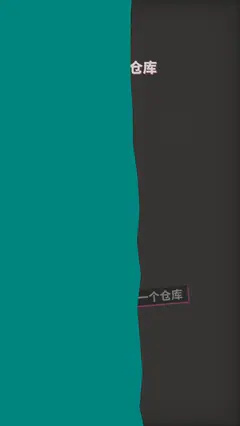

# `logo_wall` · 

 

**怎么动**：

| 项 | 内容 |
|---|---|
| 类别 | 照片 |
| 适合的句子 | 这些公司都在用、合作方、投资组合 |
| 建议时长 | 4–5 秒 |
| 参数 | `hl`, `kicker`, `logos`, `names`, `sub`, `t_hl`, `title` |
| 横屏 / 竖屏 | ✓ / ✓（尺寸用 vmin，竖屏自动缩放） |
| 人气依据 | VideoHive Multi Video & Multi Text Logo Formation 3.8K · Mosaic Photo Reveal 16K |

```json
{
 "scene": "fx",
 "fx": "logo_wall",
 "theme": "ink",
 "topic": "做内容",
 "logos": [
  "press",
  "poster",
  "zine",
  "screen",
  "hud",
  "atlas",
  "doc",
  "papercut",
  "sketch",
  "ink",
  "flat",
  "pixel",
  "iso3d",
  "chrome3d",
  "studio",
  "clay",
  "reel"
 ],
 "hl": "ink",
 "title": "十七种风格，一个仓库",
 "sub": "ink · 水墨国风",
 "line": "十七种风格放在一个仓库里，换一种就是*一种气质*。",
 "src": "hat9-motion 风格目录",
 "t": "@关键词"
}
```

**已知坑**：只用自己的或虚构的 logo，绝不用真实品牌的标。
