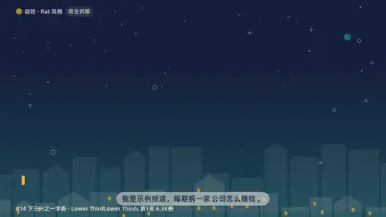
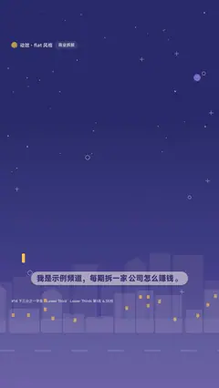

# `lower3` · 下三分之一字条 (#14, Lower Thirds 第1名 6.3K)

 

**怎么动**：accent bar grows, name slides out of a mask, role follows.

| 项 | 内容 |
|---|---|
| 类别 | 界面 |
| 适合的句子 | 人物 / 账号介绍、结尾 |
| 建议时长 | 2–3 秒 |
| 参数 | `sub`, `text` |
| 横屏 / 竖屏 | ✓ / ✓（尺寸用 vmin，竖屏自动缩放） |
| 人气依据 | Lower Thirds 第1名 6.3K份 |

```json
{
 "scene": "fx",
 "fx": "lower3",
 "theme": "paper",
 "topic": "商业拆解",
 "text": "示例频道",
 "sub": "商业拆解 · 每期拆一家公司怎么赚钱",
 "line": "我是示例频道，每期拆一家*公司怎么赚钱*。",
 "t": "@关键词"
}
```

**已知坑**：无
