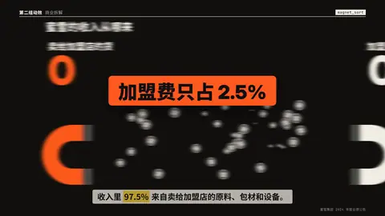

# `magnet_sort` · 磁极分拣

 

**怎么动**：几十个筹码散落在整个画面上；两块磁铁通电，每个筹码飞向自己的那一极（近的先到，带过冲落进堆里），落定时变成该极的颜色，两边计数随堆增长。看到的比例就是数据的比例：97.5% 对 2.5% 就是 39 个对 1 个。

| 项 | 内容 |
|---|---|
| 类别 | 物理 |
| 适合的句子 | 「收入里 97.5% 来自……」「多数 vs 少数」二分 |
| 建议时长 | 4–5 秒 |
| 参数 | `a` `b`（两极名字，必填）、`a_count` + `b_count` 或 `share`（a 的百分比）+ `n`（筹码数，默认 40）、`a_value` `b_value`（最后显示的数，如 "97.5%"）、`chip_a` `chip_b`（两类筹码上的字，默认取两极名字的第一个字）、`at` |
| 横屏 / 竖屏 | ✓ / ✓（竖屏：两块 380 宽的磁铁立在底边，堆往上长，两个计数上下两行（≥ 240 px）；横屏：磁铁在左右两侧朝内，堆向中间长，计数在左上 / 右上） |
| 跟风格换皮 | 颜色只用风格的 token（--bg --fg --muted --accent --card --card-fg），字体用风格的 display / body / num；没写 `theme` 时画在风格自己的底色上 |
| 什么时候用 | 一个整体分成两类、而且悬殊才是重点 |
| 什么时候不用 | 三类以上（用 stacked_bars / donut）；两边差不多时意义不大 |
| 同步口播 | 有字级时间戳（meta.words）时，条目 / 关键时刻落在说到它的那一刻；`at` 可以写 `"@词"` 或拍内秒数 |
| 缺内容 | 必填参数缺了会直接报错（不会画空骨架）；确实要骨架时写 `"skeleton": true` |

```json
{
 "scene": "fx",
 "fx": "magnet_sort",
 "topic": "商业拆解",
 "title": "蜜雪的收入从哪来",
 "a": "卖给加盟店的货",
 "b": "加盟费",
 "share": 97.5,
 "n": 40,
 "a_value": "97.5%",
 "b_value": "2.5%",
 "line": "收入里 *97.5%* 来自卖给加盟店的原料、包材和设备。",
 "src": "蜜雪集团 2024 年度业绩公告",
 "t": "@关键词"
}
```

**已知坑**：筹码数最多 80；百分比按 n 取整，所以显示值请写在 a_value / b_value 里。
