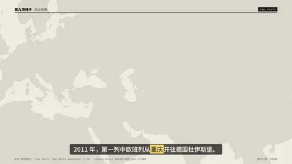
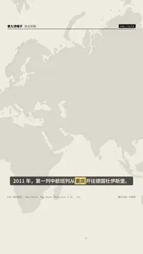

# `map_route` · 

 

**怎么动**：

| 项 | 内容 |
|---|---|
| 类别 | 地图 |
| 适合的句子 | 路线、物流、扩张、从 A 到 B |
| 建议时长 | 3–4 秒 |
| 参数 | `chips`, `from`, `from_sub`, `points`, `stops`, `to`, `to_sub` |
| 横屏 / 竖屏 | ✓ / ✓（尺寸用 vmin，竖屏自动缩放） |
| 人气依据 | Map Route Generator 3.5K · Ignace Aleya 动画旅行地图 169.5万播放 |

```json
{
 "scene": "fx",
 "fx": "map_route",
 "theme": "paper",
 "topic": "商业拆解",
 "points": [
  [
   106.55,
   29.56
  ],
  [
   108.94,
   34.34
  ],
  [
   103.83,
   36.06
  ],
  [
   87.62,
   43.83
  ],
  [
   82.57,
   45.17
  ],
  [
   73.1,
   49.8
  ],
  [
   69.15,
   54.87
  ],
  [
   37.62,
   55.75
  ],
  [
   27.56,
   53.9
  ],
  [
   23.69,
   52.09
  ],
  [
   21.01,
   52.23
  ],
  [
   6.76,
   51.43
  ]
 ],
 "from": "重庆",
 "to": "杜伊斯堡",
 "from_sub": "2011.3.19 首发",
 "to_sub": "德国 · 路线示意",
 "chips": [
  "1 万多公里",
  "约 *16* 天"
 ],
 "line": "2011 年，第一列中欧班列从*重庆*开往德国杜伊斯堡。",
 "src": "重庆日报；中新网",
 "t": "@关键词"
}
```

**已知坑**：途经点决定线走哪条走廊，只给起终点会画成大圆航线；跨日期变更线的路线会自动以路线为中心。
