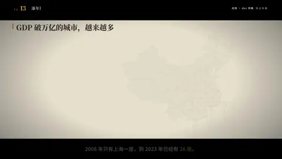

# `map_timeline` · 

 

**怎么动**：

| 项 | 内容 |
|---|---|
| 类别 | 地图 |
| 适合的句子 | 逐年扩张、城市名单按年份 |
| 建议时长 | 6–8 秒（年份多就更长） |
| 参数 | `from`, `labels`, `points`, `to`, `unit` |
| 横屏 / 竖屏 | ✓ / ✓（尺寸用 vmin，竖屏自动缩放） |
| 人气依据 | VideoHive「Map Route Generator」3.5K · 「World Map Animation」2.8K |

```json
{
 "scene": "fx",
 "fx": "map_timeline",
 "theme": "paper",
 "topic": "商业拆解",
 "title": "GDP 破万亿的城市，越来越多",
 "unit": "座万亿城市",
 "points": [
  [
   "上海",
   121.47,
   31.23,
   2006
  ],
  [
   "北京",
   116.4,
   39.9,
   2008
  ],
  [
   "广州",
   113.26,
   23.13,
   2010
  ],
  [
   "深圳",
   114.06,
   22.54,
   2011
  ],
  [
   "重庆",
   106.55,
   29.56,
   2011
  ],
  [
   "天津",
   117.2,
   39.13,
   2011
  ],
  [
   "苏州",
   120.58,
   31.3,
   2011
  ],
  [
   "成都",
   104.07,
   30.67,
   2014
  ],
  [
   "武汉",
   114.31,
   30.59,
   2014
  ],
  [
   "杭州",
   120.16,
   30.27,
   2015
  ],
  [
   "南京",
   118.8,
   32.06,
   2016
  ],
  [
   "青岛",
   120.38,
   36.07,
   2016
  ],
  [
   "无锡",
   120.31,
   31.49,
   2017
  ],
  [
   "长沙",
   112.94,
   28.23,
   2017
  ],
  [
   "宁波",
   121.55,
   29.87,
   2018
  ],
  [
   "郑州",
   113.63,
   34.75,
   2018
  ],
  [
   "佛山",
   113.12,
   23.02,
   2019
  ],
  [
   "泉州",
   118.68,
   24.87,
   2020
  ],
  [
   "济南",
   117.12,
   36.65,
   2020
  ],
  [
   "合肥",
   117.23,
   31.82,
   2020
  ],
  [
   "南通",
   120.86,
   32.01,
   2020
  ],
  [
   "西安",
   108.94,
   34.34,
   2020
  ],
  [
   "福州",
   119.3,
   26.08,
   2020
  ],
  [
   "东莞",
   113.75,
   23.02,
   2021
  ],
  [
   "常州",
   119.97,
   31.81,
   2023
  ],
  [
   "烟台",
   121.45,
   37.46,
   2023
  ]
 ],
 "line": "2006 年只有上海一座，到 2023 年已经有 *26 座*。",
 "src": "各市统计公报；人民日报海外版整理 · 底图 Natural Earth",
 "t": "@关键词"
}
```

**已知坑**：年份和坐标要真实可查；始终带南海诸岛附图。
