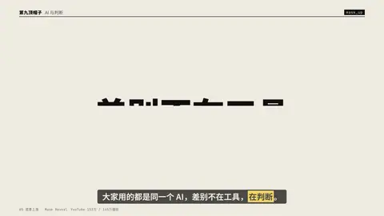
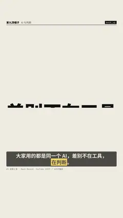

# `mask_up` · 行遮罩上移 (the most-used title reveal)

 

**怎么动**：each line rises out of its own mask, expo.out.

| 项 | 内容 |
|---|---|
| 类别 | 字效 |
| 适合的句子 | 任何标题、两行观点 |
| 建议时长 | 2–3 秒 |
| 参数 | `sub` |
| 横屏 / 竖屏 | ✓ / ✓（尺寸用 vmin，竖屏自动缩放） |
| 人气依据 | YouTube 153万 / 145万播放 |

```json
{
 "scene": "fx",
 "fx": "mask_up",
 "theme": "paper",
 "topic": "AI 与判断",
 "text": "差别不在工具|在判断",
 "sub": "the tool is not the point",
 "line": "大家用的都是同一个 AI，差别不在工具，*在判断*。",
 "host": true,
 "t": "@关键词"
}
```

**已知坑**：无
