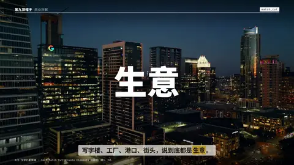
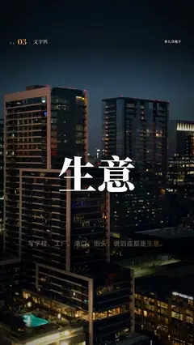

# `match_cut` · 文字匹配剪辑 Text Match Cut (#23, Envato Elements 标题热门第1/2)

 

**怎么动**：the word holds its exact place while everything around it hard-cuts — background, colour field and typeface change every few frames. Each cut is a designed pair (ground + type treatment), so the word always reads.

| 项 | 内容 |
|---|---|
| 类别 | 字效 |
| 适合的句子 | 一个词贯穿多个场景 |
| 建议时长 | 2–3 秒（每 0.22 秒一切） |
| 参数 | `images`, `text` |
| 横屏 / 竖屏 | ✓ / ✓（尺寸用 vmin，竖屏自动缩放） |
| 人气依据 | Envato Elements 标题热门第1、2名 |

```json
{
 "scene": "fx",
 "fx": "match_cut",
 "theme": "ink",
 "topic": "商业拆解",
 "text": "生意",
 "images": [
  "assets/broll/towers.jpg",
  "assets/broll/factory.jpg",
  "assets/broll/port.jpg",
  "assets/broll/crossing.jpg"
 ],
 "line": "写字楼、工厂、港口、街头，说到底都是*生意*。",
 "t": "@关键词"
}
```

**已知坑**：每个画面的底色和字色是成对设计的，换图时保持一深一浅交替。
