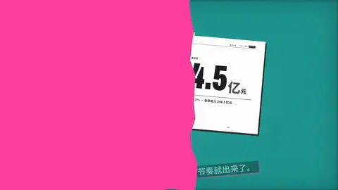
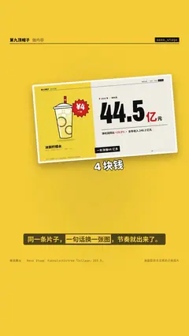

# `meme_stage` · 

 

**怎么动**：

| 项 | 内容 |
|---|---|
| 类别 | 照片 |
| 适合的句子 | 吐槽、一句一张反应图 |
| 建议时长 | 每张 ≥0.6 秒 |
| 参数 | `at`, `captions`, `images`, `items`, `mode`, `title` |
| 横屏 / 竖屏 | ✓ / ✓（尺寸用 vmin，竖屏自动缩放） |
| 人气依据 | Fakeplastictree「Collage」203.5 万 · Ben Marriott Paper Cutout 30.7 万 |

```json
{
 "scene": "fx",
 "fx": "meme_stage",
 "theme": "lemon",
 "topic": "做内容",
 "items": [
  {
   "src": "assets/meme_lemon.jpg",
   "caption": "4 块钱"
  },
  {
   "src": "assets/meme_turn.jpg",
   "caption": "不是卖奶茶"
  },
  {
   "src": "assets/meme_1997.jpg",
   "caption": "学会说不"
  }
 ],
 "line": "同一条片子，*一句话换一张图*，节奏就出来了。",
 "src": "画面取自本仓库的示例成片",
 "t": "@关键词"
}
```

**已知坑**：无
