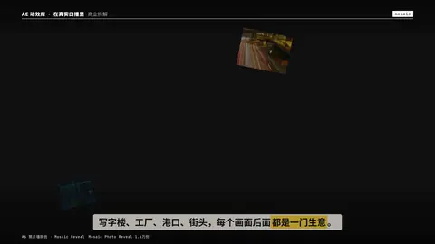
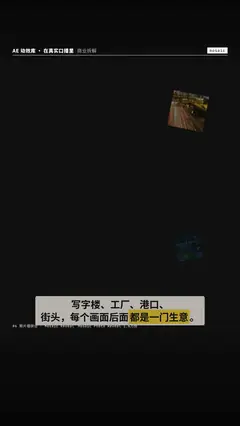

# `mosaic` · 照片墙拼合 (#6, Mosaic Photo Reveal 1.6万份)

 

**怎么动**：tiles fly in from depth and assemble a wall, then the camera pushes into one tile until it fills the frame. images: 1…24 of any aspect (fewer than 12 → varied crops; 12–24 → one tile each, the grid re-shapes to the count); clips may be mixed in (up to 6 play, the rest show a still).

| 项 | 内容 |
|---|---|
| 类别 | 照片 |
| 适合的句子 | 大量案例、作品合集 |
| 建议时长 | 2.5–3 秒 |
| 参数 | `focus`, `image`, `images`, `video` |
| 横屏 / 竖屏 | ✓ / ✓（尺寸用 vmin，竖屏自动缩放） |
| 人气依据 | Mosaic Photo Reveal 1.6万份 |

```json
{
 "scene": "fx",
 "fx": "mosaic",
 "theme": "ink",
 "topic": "商业拆解",
 "images": [
  "assets/broll/towers.jpg",
  "assets/broll/tokyo.jpg",
  "assets/broll/trails.jpg",
  "assets/broll/factory.jpg",
  "assets/broll/port.jpg",
  "assets/broll/meeting.jpg",
  "assets/broll/crossing.jpg",
  "assets/broll/office.jpg",
  "assets/broll/screens.jpg",
  "assets/broll/cranes.jpg",
  "assets/broll/nightroad.jpg",
  "assets/broll/charts.jpg"
 ],
 "line": "写字楼、工厂、港口、街头，每个画面后面*都是一门生意*。",
 "t": "@关键词"
}
```

**已知坑**：无
