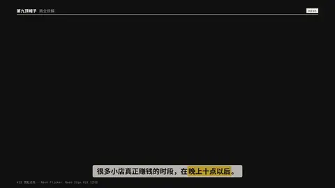
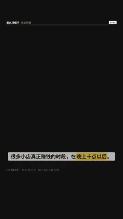

# `neon` · 霓虹点亮 (#12, Neon Sign Kit 1万份)

 

**怎么动**：tube text stutters on (stepped flicker pattern), then holds with a steady glow.

| 项 | 内容 |
|---|---|
| 类别 | 字效 |
| 适合的句子 | 夜景、潮流、店招 |
| 建议时长 | 2–3 秒 |
| 参数 | `color`, `text` |
| 横屏 / 竖屏 | ✓ / ✓（尺寸用 vmin，竖屏自动缩放） |
| 人气依据 | Neon Sign Kit 1万份 |

```json
{
 "scene": "fx",
 "fx": "neon",
 "theme": "ink",
 "topic": "商业拆解",
 "text": "OPEN 24H",
 "line": "很多小店真正赚钱的时段，在*晚上十点以后*。",
 "t": "@关键词"
}
```

**已知坑**：无
