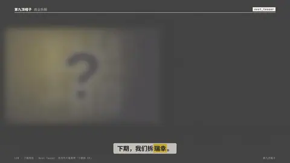
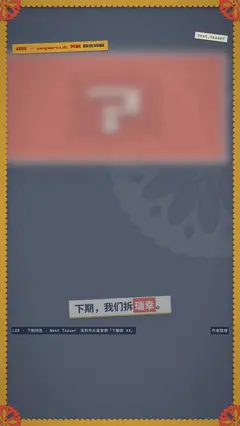

# `next_teaser` · 

 

**怎么动**：

| 项 | 内容 |
|---|---|
| 类别 | 类型 |
| 适合的句子 | 片尾预告下一期 |
| 建议时长 | 3.5–5 秒 |
| 参数 | `ep`, `hints`, `image`, `kicker`, `note`, `text`, `title`, `video`, `when` |
| 横屏 / 竖屏 | ✓ / ✓（尺寸用 vmin，竖屏自动缩放） |
| 人气依据 | 系列号片尾常用「下期拆 XX」 |

```json
{
 "scene": "fx",
 "fx": "next_teaser",
 "theme": "ink",
 "topic": "商业拆解",
 "kicker": "下期预告",
 "ep": "EP.08",
 "title": "瑞幸 9.9 元一杯，靠什么赚钱？",
 "hints": [
  "门店模型",
  "补贴还能撑多久"
 ],
 "when": "周五见",
 "line": "下期，我们拆*瑞幸*。",
 "src": "第九顶帽子",
 "t": "@关键词"
}
```

**已知坑**：video 封面时页面底色由独立的底色层画出（paint_bg）。
