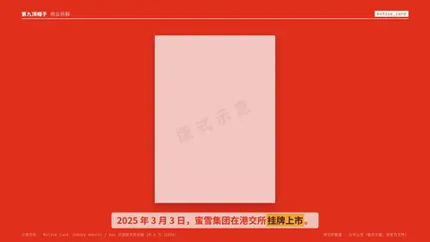
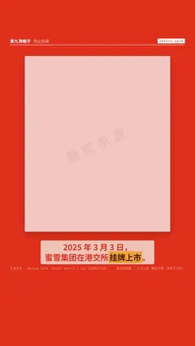

# `notice_card` · 

 

**怎么动**：

| 项 | 内容 |
|---|---|
| 类别 | 文档 |
| 适合的句子 | 公告、通知、说明（版式示意） |
| 建议时长 | 5–6 秒 |
| 参数 | `body`, `date`, `kind`, `no`, `numbered`, `org`, `signer`, `title`, `watermark` |
| 横屏 / 竖屏 | ✓ / ✓（尺寸用 vmin，竖屏自动缩放） |
| 人气依据 | Johnny Harris / Vox 式报纸文件动画 19.6 万（2024） |

```json
{
 "scene": "fx",
 "fx": "notice_card",
 "theme": "red",
 "topic": "商业拆解",
 "org": "资料卡",
 "kind": "备忘",
 "no": "H9-2026-001",
 "title": "蜜雪集团上市信息",
 "date": "2026-11-01",
 "signer": "示例频道",
 "body": [
  "上市地点：香港联合交易所主板。",
  "*上市日期：2025 年 3 月 3 日。*",
  "股份代号：2097。"
 ],
 "line": "2025 年 3 月 3 日，蜜雪集团在港交所*挂牌上市*。",
 "src": "港交所披露 · 公司公告（版式示意，非官方文件）",
 "t": "@关键词"
}
```

**已知坑**：刻意做成普通版式：不要红头、不要公章，保留「版式示意」水印，除非是你自己的文件。
