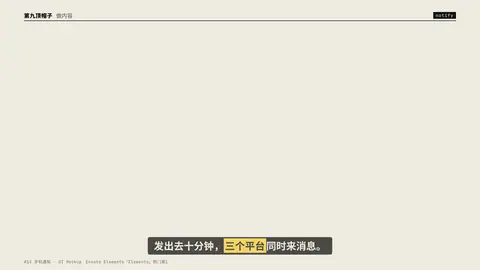
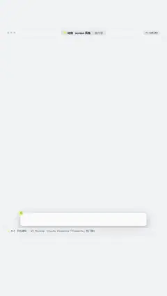

# `notify` · 手机通知界面 (#13, Envato Elements「Elements」热门第1)

 

**怎么动**：iOS-style banners drop in one after another and stack.

| 项 | 内容 |
|---|---|
| 类别 | 界面 |
| 适合的句子 | 平台反馈、增长、消息 |
| 建议时长 | 2–3 秒 |
| 参数 | `items` |
| 横屏 / 竖屏 | ✓ / ✓（尺寸用 vmin，竖屏自动缩放） |
| 人气依据 | Envato Elements「Elements」热门第1 |

```json
{
 "scene": "fx",
 "fx": "notify",
 "theme": "paper",
 "topic": "做内容",
 "items": [
  [
   "抖音",
   "你的视频播放量破 10 万"
  ],
  [
   "小红书",
   "有 326 人收藏了你的笔记"
  ],
  [
   "B站",
   "新增 128 个粉丝"
  ]
 ],
 "line": "发出去十分钟，*三个平台*同时来消息。",
 "host": true,
 "t": "@关键词"
}
```

**已知坑**：无
