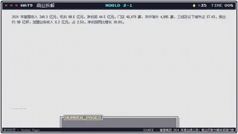
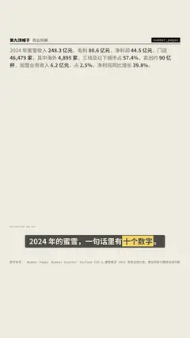

# `number_pages` · 

 

**怎么动**：

| 项 | 内容 |
|---|---|
| 类别 | 数据 |
| 适合的句子 | 一句话里很多数字（财报、快讯） |
| 建议时长 | 每个数字 0.5–0.8 秒（十个数字约 7–8 秒） |
| 参数 | `at`, `items`, `per_page`, `text` |
| 横屏 / 竖屏 | ✓ / ✓（尺寸用 vmin，竖屏自动缩放） |
| 人气依据 | Number Counter：YouTube 162.6 万 · Envato Popular「Number Counter」 |

```json
{
 "scene": "fx",
 "fx": "number_pages",
 "theme": "paper",
 "topic": "商业拆解",
 "text": "2024 年蜜雪收入 248.3 亿元，毛利 80.6 亿元，净利润 44.5 亿元，门店 46,479 家，其中海外 4,895 家，三线及以下城市占 57.4%，卖出约 90 亿杯，加盟业务收入 6.2 亿元，占 2.5%，净利润同比增长 39.8%。",
 "line": "2024 年的蜜雪，一句话里有*十个数字*。",
 "src": "蜜雪集团 2024 年度业绩公告；售出杯数为媒体报道约数",
 "t": "@关键词"
}
```

**已知坑**：数字口径一致、可查；约数在 src 里注明。
