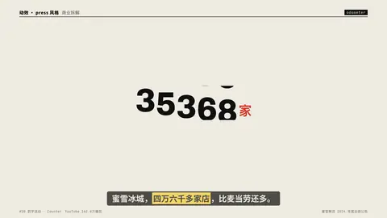

# `odometer` · 数字滚轮 (Odometer / number wheel)

 

**怎么动**：each digit column spins down to its value, staggered.

| 项 | 内容 |
|---|---|
| 类别 | 数据 |
| 适合的句子 | 任何数字、比例 |
| 建议时长 | 2–3 秒 |
| 参数 | `sub`, `unit`, `value` |
| 横屏 / 竖屏 | ✓ / ✓（尺寸用 vmin，竖屏自动缩放） |
| 人气依据 | YouTube 162.6万播放 |

```json
{
 "scene": "fx",
 "fx": "odometer",
 "theme": "paper",
 "topic": "商业拆解",
 "value": "46479",
 "unit": "家",
 "sub": "蜜雪冰城全球门店 · 截至 2024 年底",
 "line": "蜜雪冰城，*四万六千多家店*，比麦当劳还多。",
 "src": "蜜雪集团 2024 年度业绩公告",
 "host": true,
 "t": "@关键词"
}
```

**已知坑**：无
