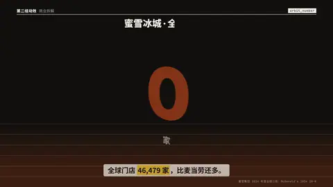

# `orbit_number` · 环绕大数

 

**怎么动**：一个占画面宽 80% 以上的数字用真 CSS 3D 挤出厚度（14 层切片，干净的深色侧壁，没有倒影），镜头绕它转 60° 同时数字往上数；几个标签钉在数字周围的空间里，随视角转动但始终面对镜头；地面有圆环和倒影。

| 项 | 内容 |
|---|---|
| 类别 | 镜头 |
| 适合的句子 | 一个值得停下来看的核心数字，配 2–4 个注脚 |
| 建议时长 | 4–5 秒 |
| 参数 | `value`（必填）、`unit`、`labels`（0–4 个注脚）、`title`、`note` |
| 横屏 / 竖屏 | ✓ / ✓（竖屏：数字在字幕带上方居中，地面渐变一直铺到底边；横屏同理） |
| 跟风格换皮 | 颜色只用风格的 token（--bg --fg --muted --accent --card --card-fg），字体用风格的 display / body / num；没写 `theme` 时画在风格自己的底色上 |
| 什么时候用 | 片子里最重要的那个数（门店数、营收） |
| 什么时候不用 | 一拍里有多个数要比（用 bars / ranking）；数字很长（> 8 位）会变小 |
| 同步口播 | 有字级时间戳（meta.words）时，条目 / 关键时刻落在说到它的那一刻；`at` 可以写 `"@词"` 或拍内秒数 |
| 缺内容 | 必填参数缺了会直接报错（不会画空骨架）；确实要骨架时写 `"skeleton": true` |

```json
{
 "scene": "fx",
 "fx": "orbit_number",
 "topic": "商业拆解",
 "title": "蜜雪冰城 · 全球门店",
 "value": "46,479",
 "unit": "家",
 "labels": [
  "比麦当劳多 3,002 家",
  "海外 4,895 家",
  "全年净增 8,914 家",
  "截至 2024-12-31"
 ],
 "line": "全球门店 *46,479 家*，比麦当劳还多。",
 "src": "蜜雪集团 2024 年度业绩公告；McDonald's 2024 10-K",
 "t": "@关键词"
}
```

**已知坑**：数字里有逗号时按逗号格式计数。
