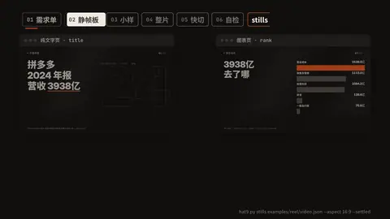
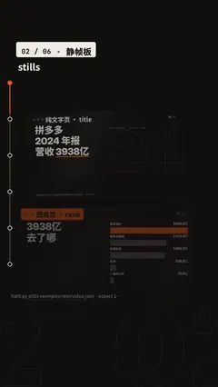

# `pair_check` · 前后对照

 

**怎么动**：两块面板（「以前」和「现在」）一起进场；然后每说一个要点：更好的那块面板上，对应区域被一个强调色圈画出来（带编号），面板下面同编号的要点词亮起、下划线擦过去，另一块面板再暗 12%、颜色再褪一点。默认区域依次是：底部一条（字幕）、中间（动效）、右边三分之一（图表）、整个画面（节奏，画成内收的圆角框），第五个是左边三分之一；可以用 `regions` 自己指定。没给图时，两块面板画成丰富程度明显不同的示意帧：手动那块只有一块图和一条细字幕；自动那块有粗字幕条和高亮词、带拖影的运动圆、会长高和起伏的柱状图、顶部节拍刻度和四角取景框，而且一直在动。
横屏：两块面板并排（各 760×428，带标题栏），要点一排在下面。竖屏：要点做成 2×2 的小块（5 个时 3 列，≥ 34 px）排在最上面；下面两块面板上下叠放，输的那块在上、820 px 宽，赢的那块在下、920 px 宽（x 40–960）并压住上面那块的下沿，下面有一道淡淡的倒影一直到画面底边；编号圈贴在圈出区域的左上外侧，碰到面板标签时挪到标签右边；标签做成面板左上角的小标签，赢的那块是强调色。

| 项 | 内容 |
|---|---|
| 类别 | 流程 · 对比 |
| 适合的句子 | 「左边是我以前手动做的，右边是它现在做的：字幕、动效、图表、节奏不是一个档次」 |
| 建议时长 | 5–7 秒 |
| 参数 | `points`（必填，2–5 个短词；多出的不显示）、`left` / `right`（`{"label": "以前 · 手动", "media": "图片或视频路径"}`，也可以只写字符串当标签；默认标签「以前」「现在」）、`winner`（`"right"` 默认 / `"left"`）、`regions`（每个要点一个 `[x, y, w, h]`，0–1 表示占面板的比例） |
| 横屏 / 竖屏 | ✓ / ✓（两套构图；1:1、4:5、3:4 用竖屏构图缩放） |
| 跟风格换皮 | 窗口用 --card / --k-r / --k-sh；圈、编号、下划线用 --accent；变暗用页面底色 |
| 什么时候用 | 同一件事前后两种做法、两种效果的逐项对照 |
| 什么时候不用 | 两个数字对比（用 `then_now`）；截图上标问题（用 `stamp_compare`） |
| 同步口播 | 每个要点在口播说到它的那一刻出现（有 `meta.words` 时），否则均匀分布在拍长 30%–82% |
| 缺内容 | 没写 `points` 会直接报错；确实要骨架时写 `"skeleton": true` |

```json
{
 "scene": "fx",
 "fx": "pair_check",
 "d": 6,
 "left": {"label": "以前 · 手动"},
 "right": {"label": "现在 · 自动"},
 "points": ["字幕", "动效", "图表", "节奏"],
 "line": "左边是我手动做的，右边是它现在做的。"
}
```

**已知坑**：给视频时面板显示视频里 1 秒处的一帧（静帧）。自定义 `regions` 时请按真实画面里的位置写，否则圈会圈在空处。要点词很长时会统一缩小，再长就省略结尾。

**实现**：`scripts/h9/fx/fx4_work.py`。
