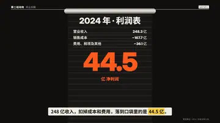

# `paper_tear` · 撕纸（转场）

 

**怎么动**：两张纸从对角合拢盖住剪辑点，接缝是一条粗糙的斜线；然后纸沿接缝撕开——露出白色纤维毛边——两半飞走，露出下一拍。纸色取风格里最浅的颜色。

| 项 | 内容 |
|---|---|
| 类别 | 转场 |
| 写法 | 写在下一个 beat 上：`"tr": "paper_tear"` |
| 适合 | 换章、换话题、拼贴感的片子 |
| 时长 | 剪辑点前后约 0.3 + 0.6 秒 |
| 参数 | — |
| 横屏 / 竖屏 | ✓ / ✓ |
| 跟风格换皮 | 颜色只用风格的 token |
| 什么时候用 | 需要一个明显的段落分隔 |
| 什么时候不用 | 同一话题内的连续两拍（太重） |

```json
{"scene": "fx", "fx": "ink_reveal", "tr": "paper_tear", "…": "…"}
```

**实现**：`scripts/h9/fx/fx2_transitions.py`，由 `scripts/h9/fx.py` 的 `transition()` 调用。
