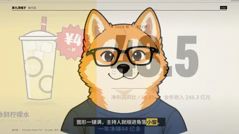
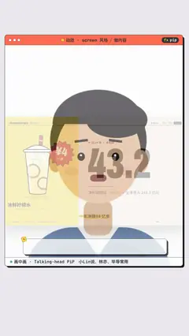

# `pip` · 

 

**怎么动**：

| 项 | 内容 |
|---|---|
| 类别 | 音视频 |
| 适合的句子 | 图形 / 素材占满屏时主持人缩进角落 |
| 建议时长 | 4–8 秒（缩窗在前 30%） |
| 参数 | `back_at`, `corner`, `focus`, `host_fit`, `host_focus`, `kicker`, `main`, `main_start`, `name`, `role`, `shape`, `size`, `title` |
| 横屏 / 竖屏 | ✓ / ✓（尺寸用 vmin，竖屏自动缩放） |
| 人气依据 | 小Lin说、林亦、毕导常用 |

```json
{
 "scene": "fx",
 "fx": "pip",
 "theme": "paper",
 "topic": "做内容",
 "main": "../../assets/previews/mixue_16x9.mp4",
 "main_start": 2.0,
 "at": 1.8,
 "name": "主持人",
 "role": "主持人",
 "line": "图形一铺满，主持人就缩进角落*小窗*。",
 "t": "@关键词"
}
```

**已知坑**：主画面是自带页眉的成片时，kicker 标签会叠在原片标题上，别加 kicker。
