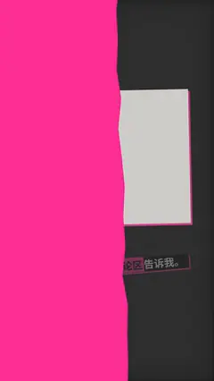

# `poll_card` · 

 

**怎么动**：

| 项 | 内容 |
|---|---|
| 类别 | 类型 |
| 适合的句子 | 引导评论、你会选哪个 |
| 建议时长 | 4–5 秒 |
| 参数 | `cta`, `hl`, `host`, `kicker`, `letters`, `mode`, `note`, `options`, `question`, `text`, `total` |
| 横屏 / 竖屏 | ✓ / ✓（尺寸用 vmin，竖屏自动缩放） |
| 人气依据 | Envato Elements Popular「YouTube Subscribe」「Checklist Pack」 |

```json
{
 "scene": "fx",
 "fx": "poll_card",
 "theme": "ink",
 "topic": "商业拆解",
 "question": "你最常点蜜雪的哪一杯？",
 "options": [
  "柠檬水",
  "冰淇淋",
  "珍珠奶茶",
  "都不喝"
 ],
 "line": "你最常点哪一杯？*评论区*告诉我。",
 "src": "第九顶帽子",
 "t": "@关键词"
}
```

**已知坑**：result 模式的百分比要真实（写 total 和来源），否则用 ask 模式。
