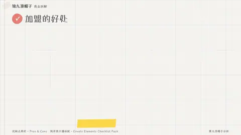

# `pros_cons` · 

 

**怎么动**：

| 项 | 内容 |
|---|---|
| 类别 | 结构 |
| 适合的句子 | 测评、优缺点、该不该 |
| 建议时长 | 2–3 秒 |
| 参数 | `cons`, `labels`, `pros`, `verdict` |
| 横屏 / 竖屏 | ✓ / ✓（尺寸用 vmin，竖屏自动缩放） |
| 人气依据 | 测评类口播标配 · Envato Elements Checklist Pack |

```json
{
 "scene": "fx",
 "fx": "pros_cons",
 "theme": "paper",
 "topic": "商业拆解",
 "labels": [
  "加盟的好处",
  "加盟的代价"
 ],
 "pros": [
  "开店快",
  "总部不出店租和人力",
  "4.6 万家店一起采购更便宜"
 ],
 "cons": [
  "品控难统一",
  "加盟店之间互相抢客",
  "一家出事，全网受影响"
 ],
 "verdict": "规模越大，管住质量越难",
 "line": "加盟模式的*好处和代价*，要一起看。",
 "src": "第九顶帽子分析",
 "t": "@关键词"
}
```

**已知坑**：无
