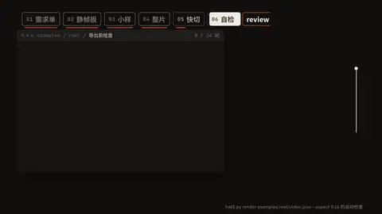
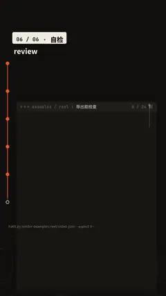

# `qc_sheet` · 逐帧检查

 

**怎么动**：一个窗口里摆着整条片子的联系表（缩略图网格）。扫描条一行一行扫过去，每个检查项扫一遍，一遍比一遍快（每遍 0.72 倍时长）；扫过的帧右下角加一个小点（每项一个），右侧清单里正在检查的那项亮起、下面计数「12 / 24」和进度条跟着走，扫完打上大勾。写了 `fail` 时，那一项扫到那一帧会停下：这一帧本来就带着毛病（黑屏是全黑、闪帧是白帧、文字重叠是叠在一起的字条，其他检查项是警示色斜纹），停下时被警示色框住、上方贴一个「× 检查项」标签，然后翻转成修好的画面、框变成正确色、标签变「已替换」，扫描继续；`fixed: false` 时保持标红，清单那项打叉。
横屏：网格窗口在左（x 110–1150，5–8 列），清单在右（x 1230–1810，检查项 60 px 大字 + 大勾框 + 计数）。竖屏：清单在上（y 300 起，一项一行，每行 100 px、检查项 ≥ 40 px），网格窗口在下面（4 列），一直铺到画面底边之外，字幕带下面也是画面。网格入场方式也不同（横屏逐列弹出，竖屏逐行落下）。

| 项 | 内容 |
|---|---|
| 类别 | 流程 · 界面 / 工作流 |
| 适合的句子 | 「导出之前，它把每一帧都检查一遍：黑屏、闪帧、文字重叠」 |
| 建议时长 | 5–7 秒 |
| 参数 | `media`（图片或视频路径列表，8–40 个；少于 8 个循环补足，多于 40 个均匀抽 40 个；视频取片中不同时刻的帧；不写就画通用的示意帧）、`count`（不写 `media` 时的帧数，默认横屏 24 / 竖屏 16，8–40）、`checks`（检查项，默认 `["黑屏","闪帧","文字重叠"]`，1–5 项，多出的不显示）、`fail`（`{"index": 7, "check": 2, "fixed": true}`，下标从 0 开始，可写负数从末尾数，越界取最近的）、`title`（标题栏路径，默认「成片 / 导出前检查」） |
| 横屏 / 竖屏 | ✓ / ✓（两套构图；1:1、4:5、3:4 用竖屏构图缩放） |
| 跟风格换皮 | 扫描条、小点、进度用 --accent；问题帧用风格警示色；强调色和警示色相同的风格（如 `reel`）里「通过」用正文色，靠勾和叉区分 |
| 什么时候用 | 讲交付前的检查、质检、批量过一遍 |
| 什么时候不用 | 要展示素材本身（用 `photo_wall` 之类） |
| 同步口播 | 扫描从拍开头约 0.5 秒开始，全部检查在拍长 85% 前结束 |
| 缺内容 | 全部参数都有默认值，只写 `fx` 也能出完整画面 |

```json
{
 "scene": "fx",
 "fx": "qc_sheet",
 "d": 6,
 "fail": {"index": 9, "check": 1},
 "line": "导出之前，它把每一帧都检查一遍。"
}
```

**已知坑**：示意帧只是通用构图（标题、图表、人像、文字页、风景、分屏），没有文字；有真实素材时请给真实帧。毛病的样子按检查项名字里的关键词选（黑 / 闪、白 / 重叠、文字、字幕）。

**实现**：`scripts/h9/fx/fx4_work.py`。
