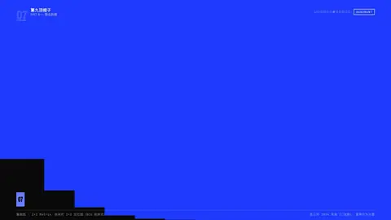
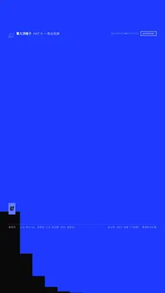

# `quadrant` · 

 

**怎么动**：

| 项 | 内容 |
|---|---|
| 类别 | 结构 |
| 适合的句子 | 定位、谁在哪个位置、2×2 矩阵 |
| 建议时长 | 2–3 秒 |
| 参数 | `hl`, `items`, `note`, `quads`, `x_axis`, `y_axis` |
| 横屏 / 竖屏 | ✓ / ✓（尺寸用 vmin，竖屏自动缩放） |
| 人气依据 | 咨询式 2×2 定位图（BCG 矩阵式） |

```json
{
 "scene": "fx",
 "fx": "quadrant",
 "theme": "ink",
 "topic": "商业拆解",
 "x_axis": [
  "便宜",
  "贵"
 ],
 "y_axis": [
  "店少",
  "店多"
 ],
 "quads": [
  "便宜又多",
  "贵还很多",
  "便宜但少",
  "贵而少"
 ],
 "items": [
  {
   "text": "蜜雪冰城",
   "x": 10,
   "y": 93
  },
  {
   "text": "瑞幸咖啡",
   "x": 42,
   "y": 45
  },
  {
   "text": "星巴克",
   "x": 86,
   "y": 80
  }
 ],
 "hl": 0,
 "note": "横轴：大致客单价 · 纵轴：全球门店数（2024）",
 "line": "又便宜、店又多，蜜雪站在*左上角*。",
 "src": "各公司 2024 年报（门店数）· 客单价为示意",
 "t": "@关键词"
}
```

**已知坑**：x、y 是 0–100 的相对位置，不是原始数值。
