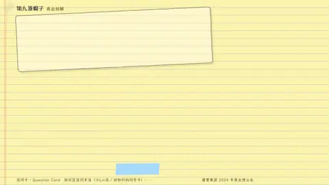
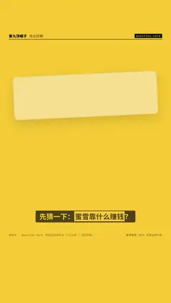

# `question_card` · 

 

**怎么动**：

| 项 | 内容 |
|---|---|
| 类别 | 结构 |
| 适合的句子 | 先抛问题再揭晓（选择题 / 翻面答案） |
| 建议时长 | 4.5–6 秒（揭晓前留 ≥ 1.5 秒） |
| 参数 | `answer`, `at_reveal`, `host`, `kicker`, `options`, `q`, `question`, `reveal`, `text` |
| 横屏 / 竖屏 | ✓ / ✓（尺寸用 vmin，竖屏自动缩放） |
| 人气依据 | 知识区设问手法（小Lin说 / 回形针的问号卡）· Kinetic Typography Pack 4.2K |

```json
{
 "scene": "fx",
 "fx": "question_card",
 "theme": "lemon",
 "topic": "商业拆解",
 "host": true,
 "kicker": "先猜一下",
 "q": "4 块钱一杯的柠檬水，蜜雪靠什么赚钱？",
 "options": [
  "🥤 卖饮品",
  "📝 收加盟费",
  "📦 卖原料和设备"
 ],
 "answer": 2,
 "reveal": "97.5% 的收入，来自卖给加盟店的商品和设备。",
 "line": "先猜一下：*蜜雪靠什么赚钱*？",
 "src": "蜜雪集团 2024 年度业绩公告",
 "t": "@关键词"
}
```

**已知坑**：答案要可查；选项 ≤ 5 字才横排。
