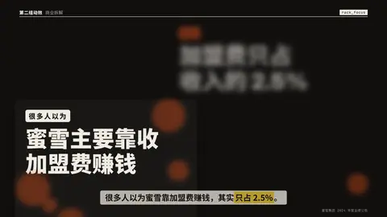
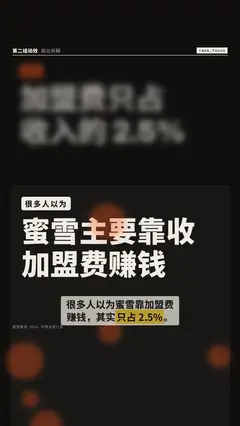

# `rack_focus` · 焦点转移

 

**怎么动**：两个不同深度的平面：近处一张卡片写「说法」，远处写「事实」。焦点从近拉到远：近处糊掉并朝镜头漂一点，远处变清楚（有一次轻微的找焦回弹）。转焦落在口播说出事实的那一刻。

| 项 | 内容 |
|---|---|
| 类别 | 镜头 |
| 适合的句子 | 「很多人以为……其实……」、前后对比、表象 vs 真相 |
| 建议时长 | 4–5 秒 |
| 参数 | `a`（近处说法）`b`（远处事实）必填、`a_label` `b_label`（小标签，如「以为」「其实」）、`at`（转焦时刻） |
| 横屏 / 竖屏 | ✓ / ✓（竖屏：事实在上半，说法卡片从中部一直延伸出底边；横屏：事实右上，卡片左下） |
| 跟风格换皮 | 颜色只用风格的 token（--bg --fg --muted --accent --card --card-fg），字体用风格的 display / body / num；没写 `theme` 时画在风格自己的底色上 |
| 什么时候用 | 纠正误解、揭示真相、两层意思要先后看 |
| 什么时候不用 | 两个观点要同时对照看（用 pros_cons / then_now） |
| 同步口播 | 有字级时间戳（meta.words）时，条目 / 关键时刻落在说到它的那一刻；`at` 可以写 `"@词"` 或拍内秒数 |
| 缺内容 | 必填参数缺了会直接报错（不会画空骨架）；确实要骨架时写 `"skeleton": true` |

```json
{
 "scene": "fx",
 "fx": "rack_focus",
 "topic": "商业拆解",
 "a_label": "很多人以为",
 "a": "蜜雪主要靠收加盟费赚钱",
 "b_label": "其实",
 "b": "加盟费只占收入的 2.5%",
 "line": "很多人以为蜜雪靠加盟费赚钱，其实*只占 2.5%*。",
 "src": "蜜雪集团 2024 年度业绩公告",
 "t": "@关键词"
}
```

**已知坑**：没有字级时间戳时在 45% 处转焦。
