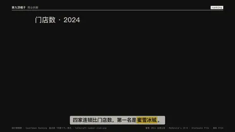

# `ranking` · 

 

**怎么动**：

| 项 | 内容 |
|---|---|
| 类别 | 结构 |
| 适合的句子 | 盘点、年度十大、门店 / 销量排行 |
| 建议时长 | 每条 0.4–0.6 秒 + 第 1 名 1.5 秒 |
| 参数 | `hide_top`, `items`, `title`, `unit` |
| 横屏 / 竖屏 | ✓ / ✓（尺寸用 vmin，竖屏自动缩放） |
| 人气依据 | 盘点类「年度十大」格式 · talkcraft number-slab-pop |

```json
{
 "scene": "fx",
 "fx": "ranking",
 "theme": "ink",
 "topic": "商业拆解",
 "title": "门店数 · 2024",
 "unit": "家",
 "items": [
  [
   "蜜雪冰城",
   46479,
   "截至 2024-12-31"
  ],
  [
   "麦当劳",
   43477,
   "截至 2024-12-31"
  ],
  [
   "星巴克",
   40199,
   "截至 2024-09-29"
  ],
  [
   "瑞幸咖啡",
   22340,
   "截至 2024-12-31"
  ]
 ],
 "line": "四家连锁比门店数，第一名是*蜜雪冰城*。",
 "src": "蜜雪 2024 业绩公告 · McDonald's 10-K · Starbucks FY24 · 瑞幸 FY24",
 "t": "@关键词"
}
```

**已知坑**：第 1 名放在 items 第一个；默认先显示问号卡再翻开，hide_top: false 关掉。
