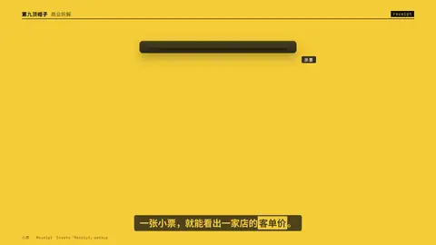

# `receipt` · 

 

**怎么动**：

| 项 | 内容 |
|---|---|
| 类别 | 界面 |
| 适合的句子 | 小票、账单、客单价 |
| 建议时长 | 2–3 秒 |
| 参数 | `currency`, `discount`, `items`, `mock`, `mock_label`, `no`, `note`, `paid`, `seed`, `store`, `time`, `total` |
| 横屏 / 竖屏 | ✓ / ✓（尺寸用 vmin，竖屏自动缩放） |
| 人气依据 | Envato「Receipt」mockup |

```json
{
 "scene": "fx",
 "fx": "receipt",
 "theme": "lemon",
 "topic": "商业拆解",
 "mock": true,
 "line": "一张小票，就能看出一家店的*客单价*。",
 "store": "某茶饮店",
 "time": "15:20",
 "no": "0427",
 "paid": "移动支付",
 "items": [
  [
   "冰鲜柠檬水",
   2,
   4
  ],
  [
   "招牌奶茶",
   1,
   8
  ],
  [
   "加料 · 珍珠",
   1,
   1
  ]
 ],
 "t_total": 36.3,
 "t": "@关键词"
}
```

**已知坑**：无
