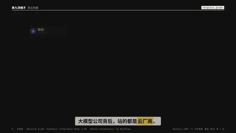

# `relation_graph` · 

 

**怎么动**：

| 项 | 内容 |
|---|---|
| 类别 | 人物 |
| 适合的句子 | 谁投资谁、背后都是谁、阵营关系 |
| 建议时长 | 每条边 0.5–0.7 秒 + 高亮 1.5 秒 |
| 参数 | `hl`, `layout`, `t_hl` |
| 横屏 / 竖屏 | ✓ / ✓（尺寸用 vmin，竖屏自动缩放） |
| 人气依据 | VideoHive Infographic Maker 2.6K · Envato Infographics「AI Workflow」 |

```json
{
 "scene": "fx",
 "fx": "relation_graph",
 "theme": "ink",
 "topic": "商业拆解",
 "line": "大模型公司背后，站的都是*云厂商*。",
 "nodes": [
  {
   "id": "微软",
   "sub": "Microsoft"
  },
  {
   "id": "亚马逊",
   "sub": "Amazon"
  },
  {
   "id": "谷歌",
   "sub": "Google"
  },
  {
   "id": "OpenAI",
   "sub": "ChatGPT"
  },
  {
   "id": "Anthropic",
   "sub": "Claude"
  }
 ],
 "edges": [
  {
   "from": "微软",
   "to": "OpenAI",
   "label": "约 130 亿美元",
   "value": 13
  },
  {
   "from": "亚马逊",
   "to": "Anthropic",
   "label": "80 亿美元",
   "value": 8
  },
  {
   "from": "谷歌",
   "to": "Anthropic",
   "label": "约 30 亿美元",
   "value": 3
  },
  {
   "from": "OpenAI",
   "to": "Anthropic",
   "label": "竞争",
   "kind": "compete"
  }
 ],
 "hl": "Anthropic",
 "t_hl": 3.8,
 "src": "Reuters、CNBC、FT 公开报道，截至 2025 年 1 月",
 "t": "@关键词"
}
```

**已知坑**：金额写清口径和截止时间（src）；不确定的关系用「示意」，别编。
