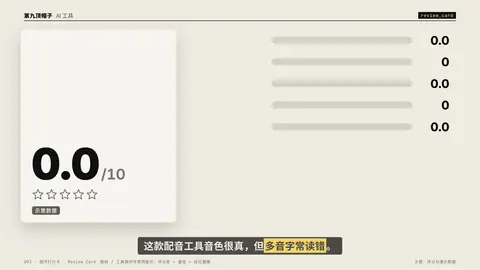
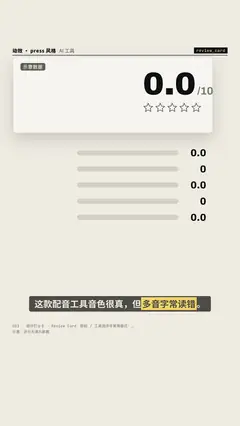

# `review_card` · 

 

**怎么动**：

| 项 | 内容 |
|---|---|
| 类别 | 类型 |
| 适合的句子 | 测评、打分、该不该买 |
| 建议时长 | 4.5–6 秒 |
| 参数 | `at`, `cons`, `image`, `labels`, `max`, `note`, `overall`, `product`, `pros`, `scores`, `stars`, `sub`, `text`, `title`, `verdict`, `verdict_kind` |
| 横屏 / 竖屏 | ✓ / ✓（尺寸用 vmin，竖屏自动缩放） |
| 人气依据 | 数码 / 工具测评号常用版式：评分条 + 星级 + 结论徽章 |

```json
{
 "scene": "fx",
 "fx": "review_card",
 "theme": "paper",
 "topic": "AI 工具",
 "product": "某款 AI 配音工具",
 "sub": "月付 ¥39 · 中文 / 英文 · 网页版",
 "scores": [
  [
   "音色自然",
   8.5
  ],
  [
   "生成速度",
   9
  ],
  [
   "中文多音字",
   6.5
  ],
  [
   "价格",
   6
  ],
  [
   "可控性",
   7.5
  ]
 ],
 "pros": [
  "音色接近真人",
  "一分钟出一条",
  "支持情绪标签"
 ],
 "cons": [
  "多音字常读错",
  "长文本要分段"
 ],
 "verdict": "看需求",
 "note": "示意数据",
 "line": "这款配音工具音色很真，但*多音字常读错*。",
 "src": "示意：评分为演示数据",
 "t": "@关键词"
}
```

**已知坑**：分数要有出处，没有就写 note: 示意数据；stars: false 关掉星级。
