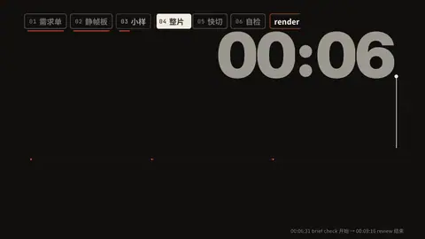
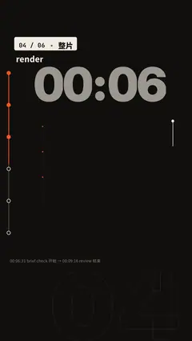

# `run_clock` · 夜里跑完 · Run Clock

 

**怎么动**：一块数字挂钟（等宽数字，每一位单独滚动，不是淡入淡出）和一条轨道。每到一个阶段：时钟滚到这个阶段的时间 → 节点弹出（0 → 1.15 → 1，6 帧）→ 一条线从上一个节点画过来 → 这个阶段的缩略图从节点里滑出来。节点在轨道上的位置**按真实时间成比例**，跨过午夜也算得对（时钟旁边弹出「次日」）。最后一个括号把整条轨道括起来，下面是**算出来的**总时长（如「1 小时 54 分」）和起止时间。

| 项 | 内容 |
|---|---|
| 类别 | 流程 · 时间 |
| 适合的句子 | 「23:29 发出去一段话，我就去睡了，01:23 全做完了」「从开工到交付一共 3 小时」 |
| 建议时长 | 6–8 秒（阶段多时取长） |
| 横屏 / 竖屏 | ✓ / ✓（两种构图，见下） |

**参数**

| 参数 | 类型 | 默认 | 说明 |
|---|---|---|---|
| `stages` | 列表（必填） | — | 1–7 个 `{"label": "查资料", "at": "23:31", "media": 可选图片}`；`at` 写 `HH:MM`（也认 `23：31`、`23点31`）；想对口播时间可加 `cue`（`"@词"` 或秒数） |
| `start` | `HH:MM` | 无（从第一个阶段算起） | 开始时间，轨道起点画一个实心节点 |
| `end` | `HH:MM` | 最后一个阶段的时间 | 单独的结束时间，轨道终点多一个实心节点 |
| `total_label` | 文字 | 自动算 | 你写的总时长；和算出来的差一分钟以上时，构建打印警告并显示算出来的值 |
| `note` | 文字 | 无 | 时钟旁 / 下面的一句，如「发完一段话，我去睡了」 |

**横屏 vs 竖屏**

- 16:9：时钟在右上（y 130–350，右对齐 x 1780，字形高约 204 px），`note`（≥ 44 px）在左边同一行；轨道在 y 720 横贯全宽（x 140–1780），缩略图 320×180 在节点上方、底边在 y 680（彼此不重叠，必要时向旁边让开并用细线连回节点）；阶段多到放不下时先按规则缩到 240 px，再放不下轨道就加长、镜头跟着最新的节点走，滑出画面的部分在边缘淡出。时间（≥ 30 px）和标签（≥ 34 px）在轨道下方；两个阶段挨得太近时，后一个的时间和标签挪到它自己的缩略图上方。括号在 y 852 括住整条轨道，总时长（≥ 56 px）在下面。
- 9:16：时钟在上（y 300 起，字形高约 200 px），`note`（≥ 34 px）在下面；轨道竖着走（x 200），每个阶段一行：节点、时间（36 px 等宽）、标签（≥ 44 px），行距按时间比例、最少 150 px，只排到 y 1350（字幕带上方）；总时长 66 px；轨道比画面长时镜头跟着最新的节点往下走（停在整行上，不切半行），最后停在总时长牌上。各阶段的缩略图是底部一排竖长卡片（y 1528 起，在字幕和来源行下面，一直铺到画面底边之外），到哪个阶段哪张升上来。
- 1:1 / 4:5 / 3:4 用竖屏构图缩放。

**读不出的时间**：某个 `at` 不是 `HH:MM` 时，构建打印警告；这个阶段在相邻两个阶段之间均分位置，原样显示你写的字，时钟停在上一个读得出的时间上。起点或终点读不出时不显示总时长（除非写了 `total_label`）。

**跟风格换皮**：时钟用风格的数字字体（`--f-num`）、等宽数字；节点、连线和时间用强调色（不够醒目时换前景色）；缩略图、阶段卡和总时长牌用风格的卡片色、圆角（上限 18 px）和阴影。

```json
{
 "scene": "fx",
 "fx": "run_clock",
 "start": "23:29",
 "note": "发完一段话，我去睡了",
 "stages": [
  {"label": "写分镜", "at": "23:31", "media": "shots/board.jpg"},
  {"label": "出静帧", "at": "23:48", "media": "shots/stills.jpg"},
  {"label": "整片渲染", "at": "00:57", "media": "shots/render.jpg"},
  {"label": "自检", "at": "01:23", "media": "shots/review.jpg"}
 ],
 "line": "23:29 发出去，01:23 就做完了。"
}
```

**已知坑**：只认 24 小时制的「时:分」，不认日期；相邻阶段之间的时间差超过 24 小时会被当成同一天之内。竖屏阶段多时，最后一屏只看得到最后几行（前面的已经被镜头带过去）；底部缩略图一排最多放 7 张，越多越窄。

**实现**：`scripts/h9/fx/fx4_flow.py`。
