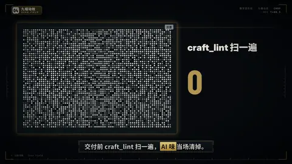

# `scan_field` · 扫描清除 · Scan Field

 

**怎么动**：一块几千个点组成的噪点带，一条带拖尾光的扫描线扫过；它经过的被标记的点闪一下强调色后消失，身后的点明显变稀，旁边的计数器跟着扫描同步上涨；扫描头上可以挂一个标签。

**什么时候用**：「清掉了 / 删掉了 / 过滤掉了」：清理不活跃用户、去重、过滤垃圾、扫掉问题。

| 项 | 内容 |
|---|---|
| 类别 | 数字变形状 |
| 建议时长 | 4.5–5.5 秒 |
| 横屏 / 竖屏 | ✓ / ✓ |

**参数**

| 参数 | 说明 |
|---|---|
| `value` | 清掉的数（可带前后缀） |
| `ratio` | 被清掉的点的比例，0.05–0.9，默认 0.38 |
| `kicker` | 数字上面的一句 |
| `unit` | 数字下面的说明 |
| `tag` | 扫描头上的标签 |
| `direction` | ltr | rtl |
| `subject / subject_label` | 主体小卡 |
| `mock` | 示意标签 |

```json
{
 "scene": "fx",
 "fx": "scan_field",
 "kicker": "craft_lint 扫一遍",
 "value": 12,
 "unit": "处 AI 味被清掉",
 "tag": "全片都是淡入",
 "mock": "示意",
 "line": "交付前 craft_lint 扫一遍，*AI 味*当场清掉。",
 "t": "@关键词"
}
```

所有这一组效果（数字变形状）：颜色、字体、圆角、描边、阴影、入场缓动都取自当前风格（26 种风格自动换皮）；横竖屏同一套参数；可选 `subject`（图片或视频）把主讲人放在旁边的小卡里。

**已知坑**：点越多越细腻，但超过约 4200 个会自动加大点距。
