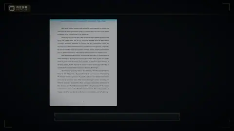
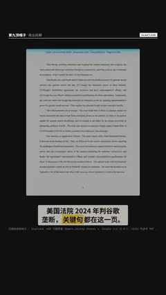

# `scanline` · 

 

**怎么动**：

| 项 | 内容 |
|---|---|
| 类别 | 引用 |
| 适合的句子 | 在文件 / 截图里逐条找出关键句 |
| 建议时长 | 5–6 秒（每块约 0.6 秒） |
| 参数 | `at`, `blocks`, `dir`, `image`, `text` |
| 横屏 / 竖屏 | ✓ / ✓（尺寸用 vmin，竖屏自动缩放） |
| 人气依据 | HUD 扫描界面（Quantum HUD Infographic 5.9K） |

```json
{
 "scene": "fx",
 "fx": "scanline",
 "theme": "ink",
 "topic": "商业拆解",
 "image": "assets/us_v_google_p8.png",
 "blocks": [
  {
   "box": [
    11.2,
    12.6,
    78.2,
    6.0
   ],
   "label": "结论：谷歌是垄断者",
   "value": "Sec. 2"
  },
  {
   "box": [
    47.4,
    23.0,
    41.0,
    3.0
   ],
   "label": "在搜索市场有垄断力",
   "value": "(2)"
  },
  {
   "box": [
    66.8,
    33.5,
    22.0,
    3.0
   ],
   "label": "广告收取超竞争价格",
   "value": "p.4"
  },
  {
   "box": [
    32.8,
    44.0,
    37.0,
    3.0
   ],
   "label": "搜索广告市场：不构成垄断",
   "value": "(1)"
  }
 ],
 "line": "美国法院 2024 年判谷歌垄断，*关键句*都在这一页。",
 "src": "United States v. Google LLC（D.D.C. 2024）判决书 PDF 第 8 页，公有领域",
 "t": "@关键词"
}
```

**已知坑**：box 要对准原图里的真实位置；标签只是摘要，原文才是证据。
