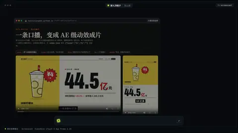

# `screencast` · 

 

**怎么动**：

| 项 | 内容 |
|---|---|
| 类别 | 屏幕 |
| 适合的句子 | 真实录屏、教程、产品演示 |
| 建议时长 | 跟录屏一样长（3–10 秒） |
| 参数 | `clicks`, `clicks_json`, `cursor`, `dark_chrome`, `frame`, `hl`, `image`, `start`, `steps`, `tab`, `url`, `video` |
| 横屏 / 竖屏 | ✓ / ✓（尺寸用 vmin，竖屏自动缩放） |
| 人气依据 | VideoHive iTouch 2 App Promo 2.1K |

```json
{
 "scene": "fx",
 "fx": "screencast",
 "theme": "ink",
 "topic": "怎么用",
 "video": "assets/gallery_rec.mp4",
 "clicks_json": "assets/gallery_rec.json",
 "url": "daiyixiang666.github.io/hat9-motion/gallery/",
 "tab": "九帽动效画廊",
 "steps": [
  "选「数据」分类",
  "点搜索框",
  "搜「增长」，点名字复制 id"
 ],
 "line": "在画廊里选*数据*，再搜增长，点名字就复制好了。",
 "t": "@关键词"
}
```

**已知坑**：clicks 里的 t 是录屏里的秒数，at 是这一拍里的秒数或 "@关键词"。
