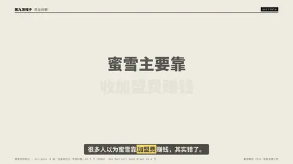
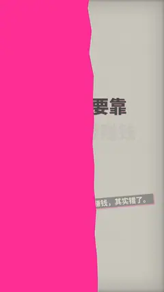

# `scribble` · 

 

**怎么动**：

| 项 | 内容 |
|---|---|
| 类别 | 字效 |
| 适合的句子 | 推翻一个常见误解、在原文 / 截图上圈重点 |
| 建议时长 | 4–5 秒 |
| 参数 | `at`, `image`, `ink`, `scribbles`, `text`, `theme` |
| 横屏 / 竖屏 | ✓ / ✓（尺寸用 vmin，竖屏自动缩放） |
| 人气依据 | B 站「白菜和杜比 手绘科普」69.9 万（2026）· Ben Marriott Hand Drawn 45.4 万 |

```json
{
 "scene": "fx",
 "fx": "scribble",
 "theme": "paper",
 "topic": "商业拆解",
 "text": "蜜雪主要靠|收加盟费赚钱",
 "line": "很多人以为蜜雪靠*加盟费*赚钱，其实错了。",
 "src": "蜜雪集团 2024 年度业绩公告",
 "scribbles": [
  {
   "type": "cross",
   "target": "收加盟费",
   "note": "加盟费只占 2.5%"
  },
  {
   "type": "underline",
   "target": "蜜雪主要靠",
   "note": "卖原料和设备才是 97.5%"
  }
 ],
 "t": "@关键词"
}
```

**已知坑**：target 要是原文里真实存在的词；图片模式的 box 用百分比。
