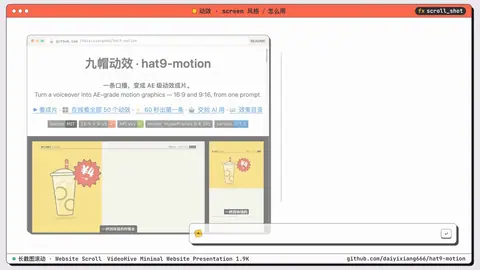
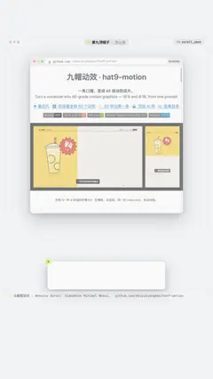

# `scroll_shot` · 

 

**怎么动**：

| 项 | 内容 |
|---|---|
| 类别 | 屏幕 |
| 适合的句子 | 长截图、网页、长聊天记录 |
| 建议时长 | 每个停点 1–1.5 秒 |
| 参数 | `dark_chrome`, `frame`, `image`, `shot`, `tab`, `toc`, `url` |
| 横屏 / 竖屏 | ✓ / ✓（尺寸用 vmin，竖屏自动缩放） |
| 人气依据 | VideoHive Minimal Website Presentation 1.9K |

```json
{
 "scene": "fx",
 "fx": "scroll_shot",
 "theme": "paper",
 "topic": "怎么用",
 "image": "assets/readme.jpg",
 "url": "github.com/daiyixiang666/hat9-motion",
 "tab": "README",
 "stops": [
  {
   "heading": "装上就有",
   "label": "装上就有"
  },
  {
   "heading": "成片示例",
   "label": "成片示例"
  },
  {
   "heading": "安装",
   "label": "安装"
  }
 ],
 "line": "README 一屏装不下，我们滚到*装上就有*这一节。",
 "src": "github.com/daiyixiang666/hat9-motion",
 "t": "@关键词"
}
```

**已知坑**：停点用 heading / find 时，截图旁要有 webpage.mjs 生成的同名 .json。
