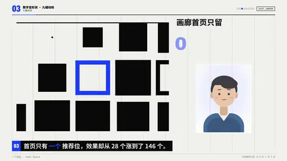

# `seat_swarm` · 一个空位 · Seat Swarm

 

**怎么动**：一排排座位几乎坐满，一个空位亮起虚线圈和标签；彩色小点一波一波从四周涌向它、绕着它转，旁边的计数器按锚点一级级跳（28 → 88 → 174），每跳一下都有回弹。

**什么时候用**：稀缺和需求：「只有 1 个名额，100+ 人申请」「首页只有一个推荐位」「每空出一个位置就被抢走」。

| 项 | 内容 |
|---|---|
| 类别 | 数字变形状 |
| 建议时长 | 4.5–6 秒 |
| 横屏 / 竖屏 | ✓ / ✓ |

**参数**

| 参数 | 说明 |
|---|---|
| `steps` | [[数值, 时间], …]，时间可写秒（拍内）或 "@关键词"；数值可带后缀（"100+"）；不写时间就均分 |
| `value` | 只有一个数时用 |
| `kicker` | 数字上面的一句 |
| `unit` | 数字下面的单位/说明 |
| `seat_label` | 空位上的标签，默认「1 个空位」 |
| `dots` | 涌入的点数，默认 72 |
| `rows` | 座位行数 |
| `subject / subject_label` | 主体小卡（计数器挪到它旁边） |
| `mock` | 示意标签 |

```json
{
 "scene": "fx",
 "fx": "seat_swarm",
 "kicker": "画廊首页只留",
 "seat_label": "1 个推荐位",
 "steps": [
  [
   28,
   1.6
  ],
  [
   88,
   2.6
  ],
  [
   "146",
   3.6
  ]
 ],
 "unit": "个效果在抢",
 "subject": "../../assets/host.webm",
 "line": "首页只有 *一个* 推荐位，效果却从 28 个涨到了 146 个。",
 "t": "@关键词"
}
```

所有这一组效果（数字变形状）：颜色、字体、圆角、描边、阴影、入场缓动都取自当前风格（18 种风格自动换皮）；横竖屏同一套参数；可选 `subject`（图片或视频）把主讲人放在旁边的小卡里。

**风格改结构**：hud 的座位是细线圈、空位加十字准线和 SEAT/FREE 读数；poster 的座位是实心方块、点也是方的；ink 的座位边缘像毛笔蘸墨。点的颜色是强调色加两种同明度的转色（水墨、极简只用强调色和墨色）。

**已知坑**：点按每一级的增量分波，最后一级必须是最大的数。
