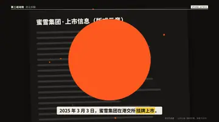
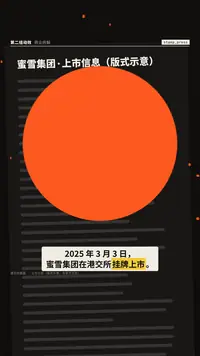

# `shape_match` · 形状匹配（转场）

 

**怎么动**：A 拍里的一个形状（默认一个圆）膨胀到盖满全屏、跨过剪辑点，再收成 B 拍里对应的形状（默认一张宽卡片），交给底下真实的那个元素。

| 项 | 内容 |
|---|---|
| 类别 | 转场 |
| 写法 | 写在下一个 beat 上：`"tr": "shape_match"` |
| 适合 | 前后两拍有形状呼应（圆章 → 纸条、圆环 → 卡片） |
| 时长 | 剪辑点前后约 0.3 + 0.6 秒 |
| 参数 | `tr_from` `tr_to`（写在下一拍上：{x, y, w, h, r}，按画面比例，r 为像素或 "50%"；可按横竖屏分写：{"9:16": {...}, "16:9": {...}}） |
| 横屏 / 竖屏 | ✓ / ✓ |
| 跟风格换皮 | 颜色只用风格的 token |
| 什么时候用 | 两拍里确实有可以对上的形状 |
| 什么时候不用 | 没有对应形状时默认几何会盖住画面主体 |

```json
{"scene": "fx", "fx": "unroll", "tr": "shape_match", "tr_from": {"9:16": {"x": 0.13, "y": 0.195, "w": 0.74, "r": "50%"}, "16:9": {"x": 0.32, "y": 0.169, "w": 0.36, "h": 0.64, "r": "50%"}}, "tr_to": {"9:16": {"x": 0.139, "y": 0.136, "w": 0.722, "h": 0.87, "r": 0}, "16:9": {"x": 0.313, "y": 0.09, "w": 0.375, "h": 0.92, "r": 0}}, "…": "…"}
```

**实现**：`scripts/h9/fx/fx2_transitions.py`，由 `scripts/h9/fx.py` 的 `transition()` 调用。
